# Hi 👋, I'm Mohammed Al Minji

  
  
  
  

### 🧭 About me

- 🔭 Currently building **[NextLine](https://github.com/moodyminji/Project-Nextline)**: a retrieval-augmented diagnostic framework for mobile device fault classification, repair guidance and authenticity scoring
- 🧳 Previously built **[RoamAura](https://github.com/moodyminji/Automated-Travel-Itinerary-Generator-SparkToCode-Project)**: an automated travel itinerary generator
- 🌱 Learning **full-stack development, AI development and mobile app development**
- 💬 Ask me about **React, Next.js and Java**
- 📫 Reach me at **mohaff990@gmail.com**

### 🛠️ Languages & tools

  

### 📊 GitHub stats

  
  

  

  <picture>
    <source media="(prefers-color-scheme: dark)" srcset="./cards/snake-dark.svg" />
    
  </picture>

Cards are rebuilt daily by <a href="./.github/workflows/profile-cards.yml">a GitHub Action</a>, so they don't depend on a public stats server.

